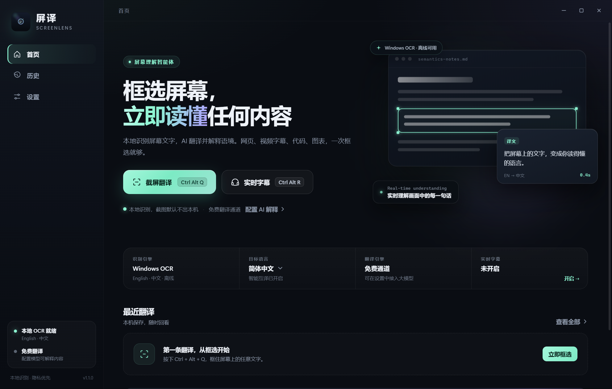
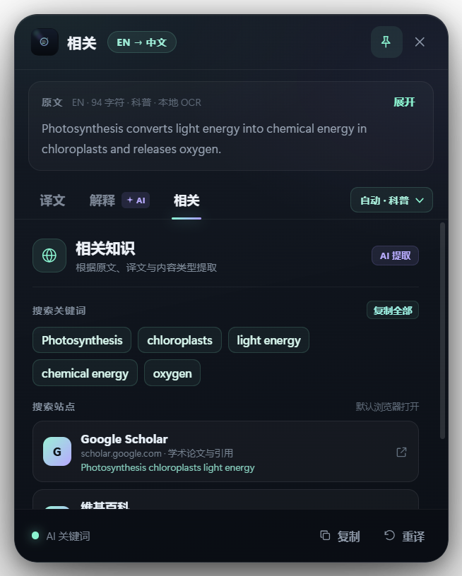
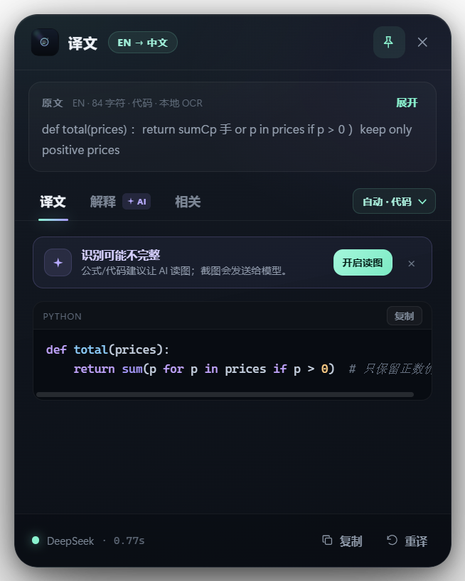
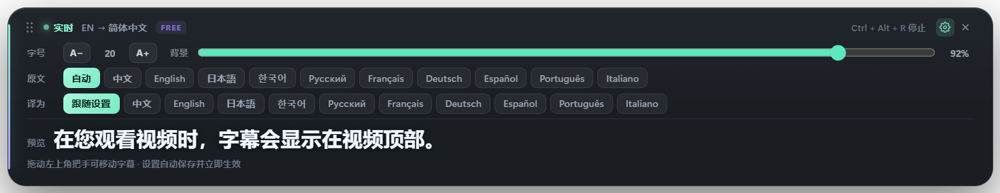
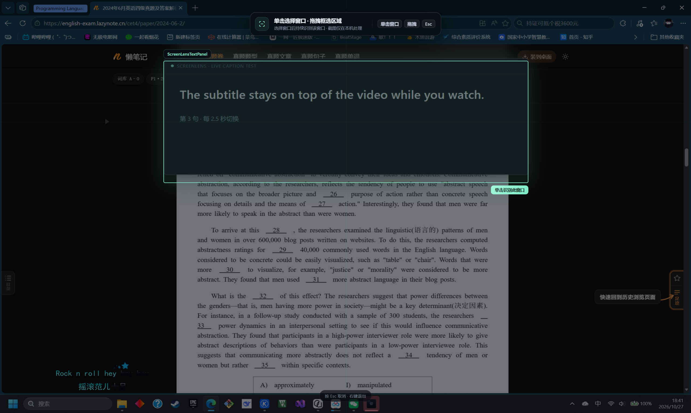
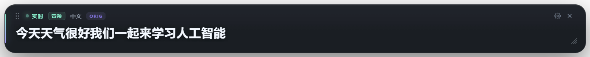

# 屏译 ScreenLens

框选 Windows 屏幕上的任意内容，立即翻译，或让 AI 解释代码、数学公式与科普文章；结果窗还会按内容类型给出相关关键词与外部搜索链接。内置本地 Windows OCR，支持实时字幕与可选的视觉读图。



## 功能

- 框选翻译：本地 Windows OCR，中英自动方向；免费翻译开箱可用。首页与结果窗都可选择 10 种译文语言，结果窗切换后立即重译并记住选择。
- AI 解释：代码逻辑、公式推导、科普背景；支持可选多模态读图。
- 相关知识：按原文、译文与领域提取关键词，提供维基百科、必应/百度、Google Scholar、Stack Overflow、GitHub、PubMed 等真实搜索链接，点击用默认浏览器打开。
- 代码 / 数学 / 科普：领域提示词、KaTeX 公式、highlight.js 代码高亮与复制。
- 实时字幕：置顶、顶部整条区域可拖动、右下角可缩放字幕框、字幕内设置（字号 / 背景透明度 / 多语言互译）、可框选区域或单击指定窗口并跟随窗口、字幕不进入截图/录屏、点击穿透、领域识别、AI/免费引擎自动选择。
- 音频字幕：系统声音回环或麦克风 → 本地 Whisper 识别（不上传音频），默认极速（首条约 2 秒、连续语音约 1 秒一更），可切均衡/准确 small，支持 10 种识别语言与自动检测；识别文字复用免费/AI 翻译并在同一字幕条显示，字幕条内可直接切换识别语言；每次停止自动保存原文/译文 TXT 记录，记录目录可在设置中更改。
- 隐私：截图默认不出本机；API Key 使用 Windows DPAPI 加密保存。

## 界面截图

| 首页 | 相关知识 |
| --- | --- |
|  |  |
|  |  |

实时字幕设置（字号、背景透明度、原文/译文语言；左上角把手可拖动，右上角 × 关闭）：



启动实时字幕时可拖拽框选区域，也可以直接单击某个窗口持续识别（悬停高亮窗口，自动跟随移动/缩放）：



音频字幕（本地 Whisper，系统声音回环）：



## 直接使用

从 GitHub Releases 下载 `ScreenLens-1.1.0-win64.zip`，解压后运行 `ScreenLens.exe`。源码仓库不包含 Electron 运行时和构建产物。

- `Ctrl+Alt+Q`：框选翻译
- `Ctrl+Alt+R`：实时字幕
- 解释与 AI 翻译需要配置 OpenAI 兼容模型；免费翻译可开箱使用
- 完整说明、隐私与许可见 `release/`，或发布包根目录

## 开发运行

首次拉取仓库后，先下载 Electron 运行时（约 300 MB，写入被 `.gitignore` 忽略的 `vendor/electron`）：

```powershell
powershell -ExecutionPolicy Bypass -File scripts/fetch-electron.ps1
```

然后运行：

```bat
start.cmd
```

Electron 版本为 38.2.1；项目本身没有 npm 依赖。

## 构建发布包

```powershell
powershell -ExecutionPolicy Bypass -File build-release.ps1
```

输出：

- `dist/release/ScreenLens/`：便携版目录
- `dist/ScreenLens-<version>-win64.zip`：发布压缩包
- `dist/ScreenLens-<version>-win64.zip.sha256.txt`：SHA256

`build-portable.ps1` 只生成目录；`build-release.ps1` 同时打包并计算哈希。`vendor/rcedit.exe`（MIT，electron/rcedit）仅用于构建时写入图标和版本信息；缺失时构建会跳过并保留 Electron 默认图标。

## 发布到 GitHub

- 源码：提交本仓库即可。默认 `.gitignore` 排除 `vendor/electron/`、`dist/`、测试截图与运行缓存。
- 便携包：把 `dist/ScreenLens-1.1.0-win64.zip` 和 `.sha256.txt` 上传到 GitHub Releases，不要提交到源码仓库（zip 约 121 MB，超过 GitHub 单文件限制）。
- 首次克隆后运行 `scripts/fetch-electron.ps1`，无需把 Electron 提交进仓库。

## 测试

```bat
set ELECTRON_RUN_AS_NODE=1
vendor\electron\electron.exe test\domain-test.js
vendor\electron\electron.exe test\search-test.js
vendor\electron\electron.exe test\code-layout-test.js
```

端到端测试通过 Electron 的 `--remote-debugging-port` 驱动（见 `test/`）；Mock 服务为 `test/mock-llm.js`（默认 127.0.0.1:11435）。

QA 汇总与真实模型验证结果见 [`docs/qa/`](docs/qa/README.md)。

## 技术结构

- `src/main.js`：Electron 主进程、托盘、快捷键、IPC
- `src/core/ocr.js` + `src/ocr/ocr-worker.ps1`：Windows OCR 常驻 worker
- `src/core/domain.js`：代码/数学/科普领域识别
- `src/core/search.js`：相关关键词、领域/主题搜索站点与 URL 编码
- `src/core/prompts.js`：领域化翻译与解释提示词
- `src/core/translate.js`、`src/core/llm.js`：免费翻译、OpenAI 兼容流式调用、代码版式修复
- `src/core/session.js`：框选 → OCR → 翻译/解释/相关知识 → 历史
- `src/core/realtime.js`：实时字幕循环
- `src/renderer/`：主界面、结果浮窗、选区覆盖层、实时字幕
- `src/renderer/vendor/`：KaTeX 0.19.1 与 highlight.js 11.11.1（离线）
- `test/`：领域/关键词测试、Mock OpenAI 服务、CDP 自动化脚本
- `scripts/fetch-electron.ps1`：拉取开发与构建所需的 Electron 运行时

## 隐私

OCR 与截图默认在本机处理。使用免费翻译时选中的文字会发给微软 Bing 翻译（失败时回退 MyMemory）；使用 AI 时选中的文字（以及开启多模态时的选区截图）会发给所配置的模型服务；使用 AI 翻译时，原文与译文还会用于提取相关搜索关键词。详见 `release/隐私说明.txt`。

## 许可

MIT，见根目录 [LICENSE](LICENSE)。第三方组件许可见 `licenses/` 与发布包中的 `LICENSES.chromium.html`。
